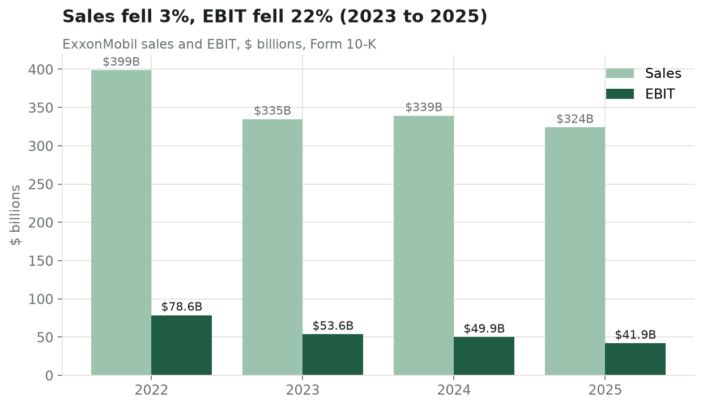
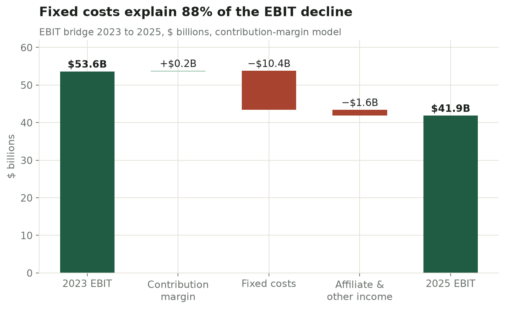
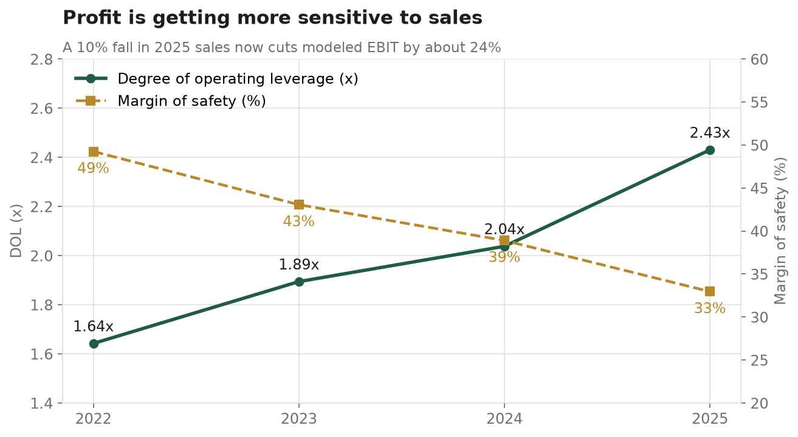
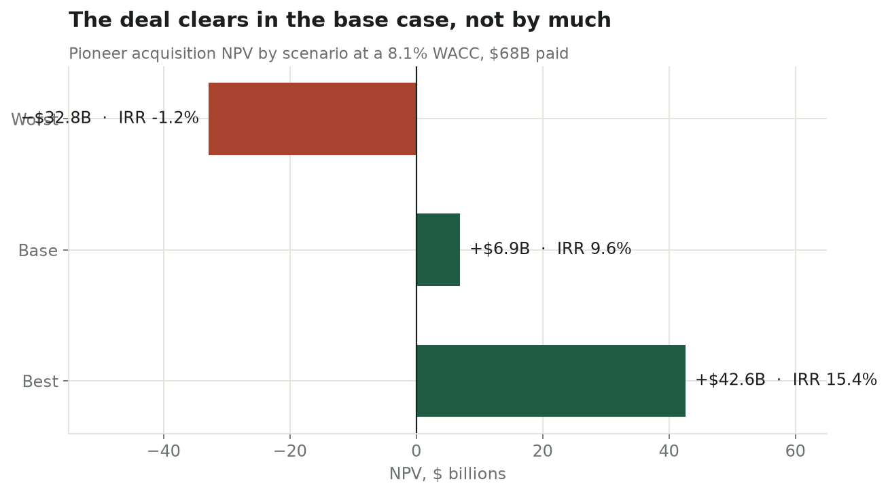
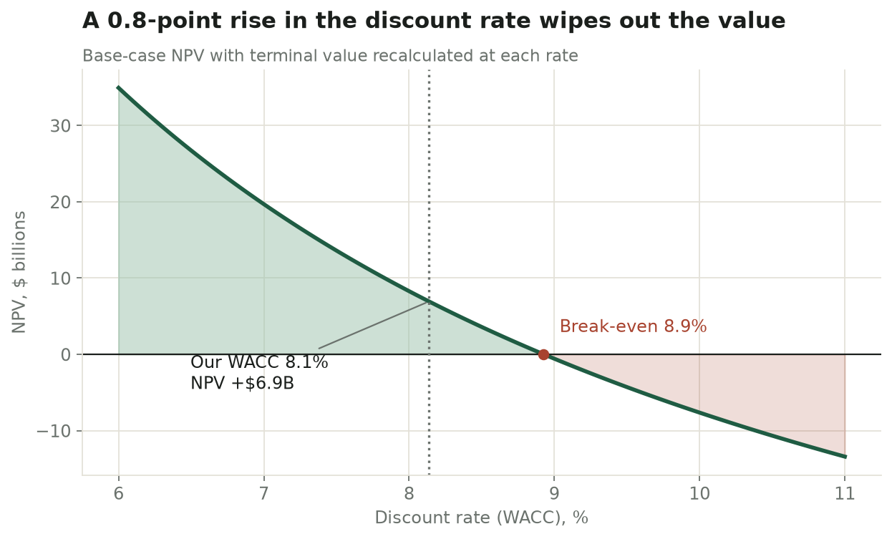
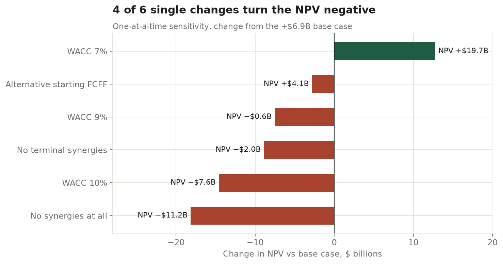

# ExxonMobil: Cost Structure, Operating Leverage and the $68B Pioneer Deal

**Why did ExxonMobil's operating profit fall 22% when sales fell only 3%, and did the Pioneer Natural Resources acquisition create value?**

A financial model built from ExxonMobil's and Pioneer's Form 10-K filings. It splits costs into fixed and variable, measures how leverage changed from 2022 to 2025, and values the 2024 Pioneer acquisition with a 10-year free-cash-flow DCF under three scenarios and six stress tests.

**[▶ Try the interactive deal calculator](https://vikrammanisankar26-cpu.github.io/exxon-pioneer-valuation/)**: move the discount rate, synergies or growth and watch the NPV change.

> Group project (5 members), Cost & Managerial Analysis (FIN-1759), Hult International Business School, November 2026. This repository rebuilds the group's Excel model in Python. The test suite checks that every headline number matches the submitted workbook.

---

## Key findings

| | |
|---|---|
| **Profit fell 22% on a 3% sales decline** | EBIT went from $53.6B (2023) to $41.9B (2025) while sales slipped from $334.7B to $323.9B. |
| **Fixed costs explain 88% of the drop** | Contribution margin held at ~31% of sales, but costs classified as fixed rose $10.4B (+18%). |
| **Operating leverage rose from 1.89x to 2.43x** | A 10% fall in sales now cuts modeled EBIT by ~24%. The margin of safety fell from 43% to 33%. |
| **Debt is not the risk** | Financial leverage of 1.01x; EBIT covers interest 69 times. |
| **Pioneer: positive, but finely balanced** | Base-case NPV **+$6.9B**, IRR 9.6% vs an 8.1% WACC. NPV turns negative above **8.9%** or if long-run synergies fade. |







## The Pioneer acquisition

ExxonMobil paid about $68B ($63B in shares plus $5B of assumed debt) for Pioneer in May 2024. We valued it as a capital investment:

- **Starting cash flow:** Pioneer's 2023 free cash flow to the firm, about $4.0B, from its own 10-K.
- **Synergies:** $2B a year pre-tax as announced in October 2023 (ExxonMobil later raised this to $3B+), ramping 40% / 70% / 100%.
- **Discount rate:** 8.14% WACC from CAPM (4.5% risk-free at deal close, beta 0.89, 5% equity risk premium) and 2025 book capital weights.
- **Terminal value:** Gordon growth at year 10, with 0% growth in the base case because oil reserves deplete.



| Scenario | Starting FCFF | Synergies | Growth yrs 1–10 | Terminal growth | NPV | IRR |
|---|---|---|---|---|---|---|
| Worst | 70% | $1.0B | −2% | −2% | −$32.8B | −1.2% |
| **Base** | 100% | $2.0B | +2% | 0% | **+$6.9B** | **9.6%** |
| Best | 115% | $3.0B | +4% | +1% | +$42.6B | 15.4% |





**Recommendation:** we would have approved the deal with conditions. The base case clears the hurdle, but terminal value is 48% of the value and the cushion on the discount rate is under one percentage point. Before committing, we would want normalized standalone cash flows, a market-based discount rate and evidence that the synergies will last.

## How the model works

```
data/xom_10k_financials.csv   ExxonMobil income statement and cash-flow lines, FY2022–FY2025
src/model.py                  cost classification, CM income statement, DOL/DFL, break-even, WACC, DCF
src/make_charts.py            builds charts/*.png and results.json
tests/test_model.py           checks the Python model against the submitted Excel workbook
docs/index.html               interactive deal calculator (no install, runs in the browser)
```

**Cost classification:** ExxonMobil does not disclose cost behavior, so we assumed it. Crude purchases and other taxes are 100% variable, production costs are 30% variable (tested at 20% and 40%), and SG&A, depreciation, exploration and pension costs are fixed. A high-low cross-check gave a higher fixed-cost estimate, which suggests this model, if anything, understates the risk.

## Run it

```bash
python3 -m pip install matplotlib numpy
python3 src/make_charts.py            # rebuild charts and results.json
python3 -m unittest -v tests/test_model.py
```

To use the calculator, open `docs/index.html` in any browser.

## Limits

- The fixed/variable split is our estimate, not a company disclosure.
- Consolidated filings do not isolate Pioneer's share of the cost increase.
- The DCF is retrospective and simplified: one year of Pioneer cash flow as the base, a group-wide discount rate and book capital weights.
- Scenario multipliers are cash-flow assumptions, not oil-price forecasts.

## Sources

- Exxon Mobil Corporation, Form 10-K for fiscal 2024 and 2025 (SEC EDGAR)
- Pioneer Natural Resources Company, Form 10-K for fiscal 2023 (SEC EDGAR)
- U.S. 10-year Treasury yield on 3 May 2024; XOM beta from Alphaspread

---

**Vikram Manisankar** · [Portfolio](https://vikrammanisankar26-cpu.github.io) · [LinkedIn](https://www.linkedin.com/in/vikram-manisankar)
